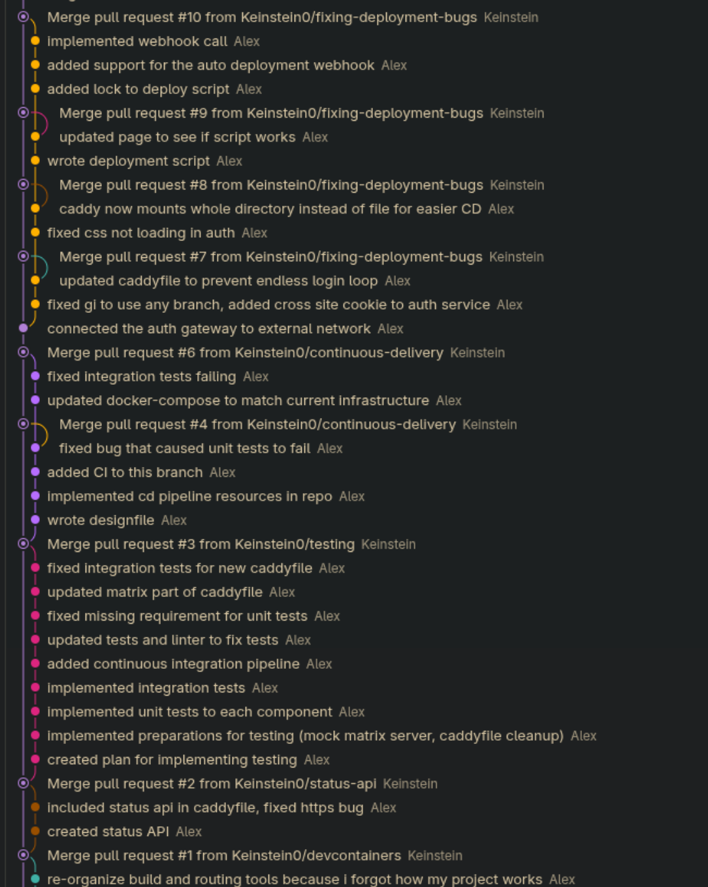

---

title: LB 234 - Dev Ops Anwenden
author: Straub Alexander
repository: https://github.com/Keinstein0/HomeserverCentral

---

# Handlungsziel 1:
## 1. Was ist Dev Ops?
Dev Ops (Development Operations) ist der bereich der sich mit dem Prozess der Softwarentwicklung befasst. Das heisst den entwicklern, die den tatsächlichen code schreiben, eine effiziente umgebung zu geben. So ist das Konfigurieren der IDE, das definieren von Versionierungsprozessen, die Anforderungs und Qualitätssicherung des geschriebenen codes sowie das Deployment des finalen projektes alles teile des bereichs Dev Ops. So zieht Dev Ops eine brücke zwischen den Entwicklern, die den Code schreiben, und dem Betrieb, der den Code laufen lässt.

### Warum braucht es Dev Ops?
Dev Ops erlaubt entwicklern in vielen art und weisen effizienter zu arbeiten. So beschleunigt es die Time to Market von individuellen Features, die mittels CI/CD automatisch getestet und Deployed werden können. Es garantiert auch die qualitätssicherung, denn dank automatisierten Unit&Integrationstests kann sichergestellt werden, dass ein feature nicht den bereits existierenden code lahmlegt. Auch strukturiert und dokumentiert es den Entwicklungsprozess klarer. Statt mündlicher chaotischer desk to desk kommunkation à "Kannst du mir den neuen Code schnell per mail schicken" sort dev ops für einen nachvollziehbaren entwicklungsprozess über standardisierte schnittstellen.

### Wichtige wörter:

- **Anforderung**: Eigenschaft die das fertige Süstem zwingend besitzen muss. ("Die texte auf der webseite sollen für personen ohne technisches wissen bearbeitbar sein")
- **Anforderungserhebung**: Der prozess in dem (z.b durch Interviews) die Wünsche und Bedürfnisse der nutzer in Konkrete anforderungen übersetzt werden
- **Anforderungsverwaltung**: Das Strukturieren, Dokumentieren, Prioritisieren und Nachverfolgen von Anforderungen über den gesamten Projektverlauf
- **Issue/Ticket**: Ein eintrag in einem Verwaltungstool für ein Feature, Bug oder eine generelle Aufgabe
- **Milestone**: Ein Zielpunkt/Zwischenstand im Projekt (z.b "UI prototyp (ohne daten) fertiggestellt ama 27. Oktober")
- **MVP** (minimum viable product): Erste funktionsfähige Version die man dem Nutzer zeigen kann.
- **Product Owner**: Verantwortlicher im Team für die vertretung der Interessen des Kunden/Marktes 
- **Requirements Management Plan** : Ein Dokument, das festlegt, wie anforderungen im Projekt erfasst, bewertet, geändert und verwaltet werden.
- **Rückverfolgbarkeit**: Die möglichkeit eine Anforderung von ihrer Entstehung zum finalen code nachzuverfolgen.
- **User Story**: Ein schema für eine anforderung aus der sicht eines Anwenders: "Als [Rolle] mächte ich [Ziel], um [Nutzen]
- **Vorlage** (für issues): Eine vordefinierte Struktur für neue Tickets mit pflichtfeldern (z.B dazugehörige Anforderung, Priorität, etc. )
- **Zuständige Person**: Person die für ein Ticket verwantwortlich ist

## 2. Anforderungsverwaltung
Für meine Anforderungsverwaltung fand ich relativ schnell zwei effektive Tools die mit bei der Anforderungsverwaltung helfen könnten:
- Github Issues
- Trello

Zu beginn des Projektes verglich ich diese miteinander um herauszufinden, welches für mein Projekt am besten geeignet wäre. 

So hatte Github klar den Vorteil da es schon in meine Versionierungssoftware eingebaut ist. Mit Github Issues kann ich einfach branches und commits an eine Anforderung anhängen. So könnte ich die Entwicklung im nachhinein Nachvollziehen. 

Der Vorteil von Trello hingegen war die starke modularität mittels extensions. Mit diesen könnte ich eben wie bei github Commits und Branches an sogenannte Karten anhängen. Ein weiterer Vorteil von trello war auch, dass ich mich damit bereits bei start des Projektes auskannte und daher recht effizient von beginn an entwickeln konnte. 

Schlussendlich entschied ich mich für Trello, da damit schon vertraut war. 

Ich modifizierte es zudem mit der GitHub erweiterung, um die prinzipien der Nachvollziehbaren entwicklung umzusetzen, sowie der Subtask extension, da ich so meine anforderungen hierarchisch sortieren konnte. 

Reflexiv betrachtet funktionierte trello schlechter als erwartet für mein Projekt. Aufgrund davon dass es ein externes tool war vergas ich oft das Board zu updaten. Auch war das ahnängen der jeweiligen Commits eine sehr zeitaufwändige sache verglichen mit wie github issues es gemacht hätte. Auch waren die Subtasks eher nachteilhaft implementiert. Ich hoffte dadurch die individuellen anforderungen auf themenbereiche zu unterteilen, jedoch führte das netto jedoch nur zu mehr chaos. 

Darauf basierend werde ich das nächste mal entweder mit Github Issues arbeiten, oder versuchen eine automatisiertere und strukturiertere lösung mit trello umzusetzen.

# Handlungsziel 2:
## 1. Meine IDE
Für meine IDE verwende ich Visual Studio Code, da es mit seinem System von Extensions eine sehr angenehme und modifizierbare Umgebung bietet. Um die Entwicklungsumgebung für alle Beteiligten zu standardisieren und zu automatisieren, befindet sich das gesamte Projekt in einem DevContainer. Das bedeutet, dass jeder Entwickler exakt dieselbe Umgebung nutzt, ohne manuell Libraries oder Tools installieren zu müssen. Die extensions die ich verwende sind die Folgenden:

### Sprachsupport für die Sprachen des Projekts (Python, Go, Svelte etc.)
Dank VSCs extensiven supports für erweiterungen kann ich synthaxhighlighting und linting direkt in der IDE machen. Dank des Devcontainers kann auch jeder der dieses Repo klont mit diesen tools arbeiten. 
### Github Actions:
Erlaubt mir von VSC aus zu sehen, wie meine automatisierte CI/CD pipeline läuft ohne im browser in github zu schauen.
### Devcontainer
Die grundlegende erweiterung, um die isolierte und reproduzierbare Entwicklungsumgebung auszuführen.
### Helpers wie "Path Intellisense" und "Add to .gitignore"
Kleine hilfreiche helfer die mir ärgerliche aufgaben mit einem click erleichtern. 
### Cline (KI integration):
Modulare Extension für Vibecoding. Unabhängig vom modell (auch wenn ich hautptsächlich glm-5.2/3-flash und gemini-3.8 verwende) und entwicklerorientiert. Sie unterstützt mich effizient beim Generieren von Boilerplate code und Beispielcode.

*Ergänzende Tests*
Zuvor versuchte ich statt Cline einige MCP servers zu installieren, jedoch stellte sich dies als nicht besonders effizient heraus, da die Cline extension schlussendlich doch eine direktere integration mit dem code hatte als alle MCPs zusammen. Auch versuchte ich zu beginn die Trello extension zu verwenden, jedoch bot diese nicht mehr Automation oder effizienz als die normale applikation wesshalb ich mich dagegen entschied diese weiter zu verwenden.

# Handlungsziel 3:
## 1. Versionierung
Um meinen code zu versionieren gibt es einige möglichkeiten. So kann man beispielsweise das ganze projekt in ein .zip file packen oder code snippets manuell sichern. Jedoch führen diese mittel sehr schnell zu sehr viel chaos. Weiter gibt es dedizierte Versionierungssysteme wie git, Subversion oder Perforce welche klarere strukturen bieten. Insbesondere git sticht hier heraus, da es heutzutage der klare industriestandard ist für solche projekte. Zudem ist git ein Verteiltes Versionierungssystem. Das heisst das auch wenn git server down wäre könnte ich immer noch auf die alten versionen meines codes zugreifen.

Ich verwende git in Kombination mit GitHub, da sich auf meinem github alle meine bisherigen privaten projekte befinden und das backup so sicher in der cloud gespeichert wird.

## 2. Arbeiten mit git in diesem Projekt
Um in meinem repository so strukturiert wie möglich zu arbeiten, sind alle relevanten elemente auf sogennantem feature branches. Der main branch agiert so als ein "source of all truth" backup mit dem erst alle änderungen mittels PRs vereint werden sobald sie vollständig und korrekt implementiert sind. 

Dieses modell funktioniert auch in softwareprojekten mit mehreren mitgliedern, denn so entwickelt jeder entwickler auf einem branch ohne sich gegenseitig in den weg zu kommen. 

Die Pull Requests erlauben mir zudem präzise zu verwalten was auf den Main branch darf und was nicht. Die automatisierten tests via GitHub actions bestätigen ausserdem dass die PR sicher ist um mit dem main branch vereint zu werden.

Im bild sieht man die interaktion zwischen den unterschiedlichen feature branches und dem main branch.

## 3. Artefaktverwaltung
Artefakte (also die generierten produkte des codes) werden im "Build" schritt der deployment pipeline automatisch generiert und auf dem ghcr als container publiziert die mein homeserver später einfach herunterladen kann. 

Statt semantic versioning verwende ich den commit hash als die version des containers, da ich so zurückverfolgen kann auf welchem stand der code jetzt genau ist, und es direkt mit dem repository abgleichen kann.

# Handlungsziel 4:
## 1. Testfälle

## 2. Unit Tests

## 3. Integration Tests

# Handlungsziel 5:
## Automatisierter Deployment Prozess

## CD auf meinen Homeserver
