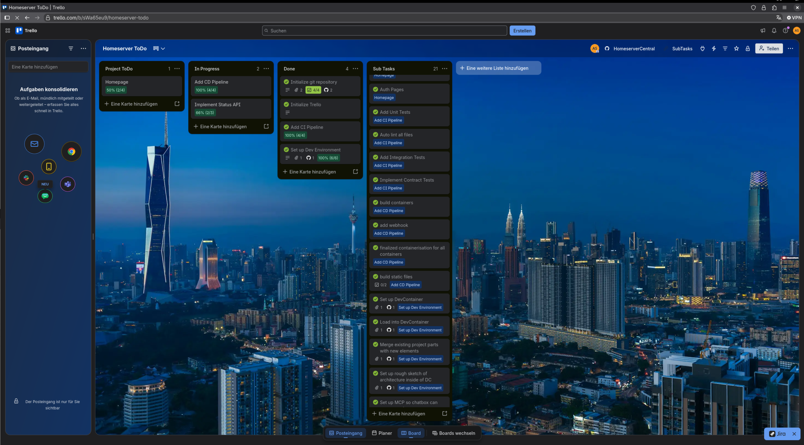

---

title: LB 234 - Dev Ops Anwenden
author: Straub Alexander

---

# Handlungsziel 1:
## 1. Was ist Dev Ops?

## 2. Anforderungsverwaltung
Für meine Anforderungsverwaltung fand ich relativ schnell zwei effektive Tools die mit bei der Anforderungsverwaltung helfen könnten:
- Github Issues
- Trello

Zu beginn des Projektes verglich ich diese miteinander um herauszufinden, welches für mein Projekt am besten geeignet wäre. 

So hatte Github klar den Vorteil da es schon in meine Versionierungssoftware eingebaut ist. Mit Github Issues kann ich einfach branches und commits an eine Anforderung anhängen. So könnte ich die Entwicklung im nachhinein Nachvollziehen. 

Der Vorteil von Trello hingegen war die starke modularität mittels extensions. Mit diesen könnte ich eben wie bei github Commits und Branches an sogenannte Karten anhängen. Ein weiterer Vorteil von trello war auch, dass ich mich damit bereits bei start des Projektes auskannte und daher recht effizient von beginn an entwickeln konnte. 

Schlussendlich entschied ich mich für Trello, da damit schon vertraut war. 

Ich modifizierte es zudem mit der GitHub erweiterung, um die prinzipien der Nachvollziehbaren entwicklung umzusetzen, sowie der Subtask extension, da ich so meine anforderungen hierarchisch sortieren konnte. 

Reflexiv betrachtet funktionierte trello schlechter als erwartet für mein Projekt. Aufgrund davon dass es ein externes tool war vergas ich oft das Board zu updaten. Auch war das ahnängen der jeweiligen Commits eine sehr zeitaufwändige sache verglichen mit wie github issues es gemacht hätte. Auch waren die Subtasks eher nachteilhaft implementiert. Ich hoffte dadurch die individuellen anforderungen auf themenbereiche zu unterteilen, jedoch führte das netto jedoch nur zu mehr chaos. 

Darauf basierend werde ich das nächste mal entweder mit Github Issues arbeiten, oder versuchen eine automatisiertere und strukturiertere lösung mit trello umzusetzen.

# Handlungsziel 2:
## 1. Meine IDE

# Handlungsziel 3:
## 1. Versionierung

## 2. Arbeiten mit git in diesem Projekt

# Handlungsziel 4:
## 1. Testfälle

## 2. Unit Tests

## 3. Integration Tests

# Handlungsziel 5:
## Automatisierter Deployment Prozess

## CD auf meinen Homeserver
